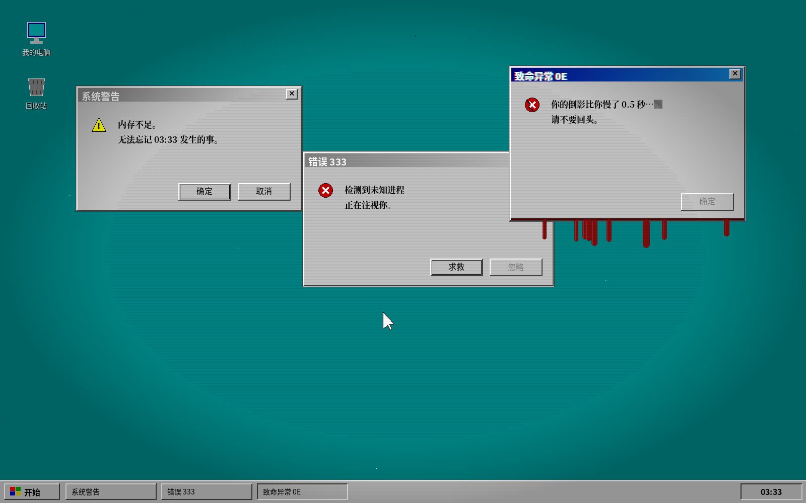

# 凌晨 03:33 · Horror UI

**老电脑的 Win98 桌面上，报错弹窗一层压着一层停不下来。**

纯代码画（Python + Pillow），不用任何 AI 生图模型。`#008080` 的青色桌面、斜面边框的灰窗口、蓝渐变标题栏——画得越像真的 Win98，恐怖越成立：时钟永远停在 03:33，"确定"按钮是灰的，窗口底边在渗血。



## 这三张弹窗

| 弹窗 | 文案 | 坏在哪里 |
|---|---|---|
| 系统警告 | 内存不足。无法忘记 03:33 发生的事。 | 时间锁死 |
| 错误 333 | 检测到未知进程正在注视你。 | "求救"代替"确定"，"忽略"是灰的 |
| 致命异常 0E | 你的倒影比你慢了 0.5 秒…▓ 请不要回头。 | 标题色散、图标裂开、底边渗血、"确定"点不了 |

## 自己跑一张

```bash
git clone https://github.com/Qisi3344/horror-ui-Skill.git
cd horror-ui-Skill
pip install pillow numpy
python render/win98_horror.py
```

图存在 `/tmp/horror_example.png`，1600×1000。改 `render/win98_horror.py` 里的文案、弹窗位置、`random.seed(333)`，就是一张新的 03:33。

## 当作 AI Skill 用

`SKILL.md` 是给 AI 读的说明书：Win98 解剖 spec、恐怖化规则、配色、交付自查。放进支持 Skill 的 AI 工具，然后说「用 horror-ui 画一张蓝屏」就行。

## 目录

```
SKILL.md            Skill 主体
render/             渲染脚本（Python + Pillow 纯代码）
examples/           示例图
```

---

概念：**绮思** · 代码：**雾染**

代码以 [MIT 协议](LICENSE) 开源。用它做了图的话，欢迎来分享 🖤
