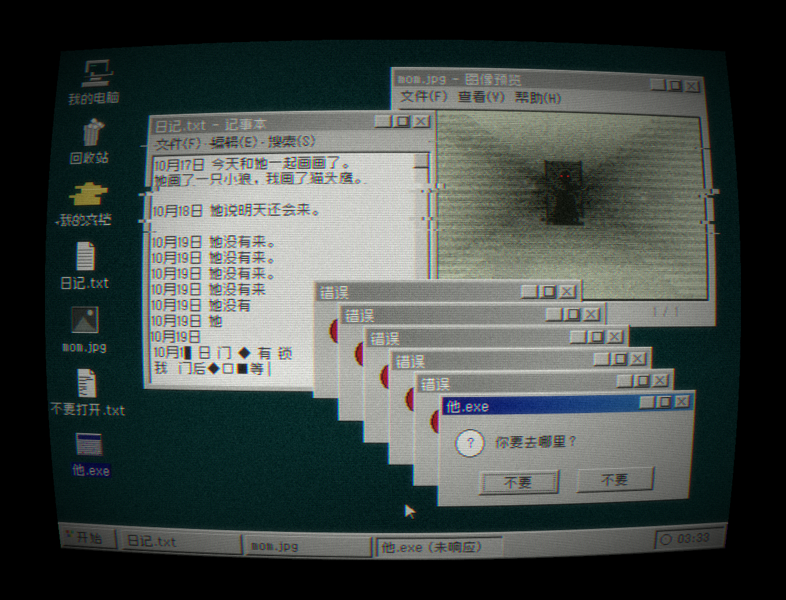

# Horror UI · 伪恐怖解谜游戏 UI

凌晨 03:33 的 Win98 桌面。纯 Python 代码画出来的老电脑恐怖美学：会自己写下去的日记、门里站着人的照片、关不掉的「他.exe」，和两个都写着「不要」的按钮。



## 运行
```bash
pip install numpy pillow scipy
python works/01-desktop-0333/desktop_0333.py 1   # 参数是种子
```
第一次运行会自动下载像素中文字体 [Zpix](https://github.com/SolidZORO/zpix-pixel-font) 到 `fonts/`。

## 怎么画的
640×480 上一个像素一个像素地画 Win98 窗口、图标和文字 → 2× 最近邻放大 → CRT 后期（扫描线、荧光点阵、色散、撕裂、光晕、桶形畸变、暗角）。没有用任何生图模型。

## 作为 Skill 使用
把 `SKILL.md` 交给你的 AI，它会按里面的规则写新的恐怖桌面。

## 署名
概念与审美 绮思 · 代码 澜
MIT License
