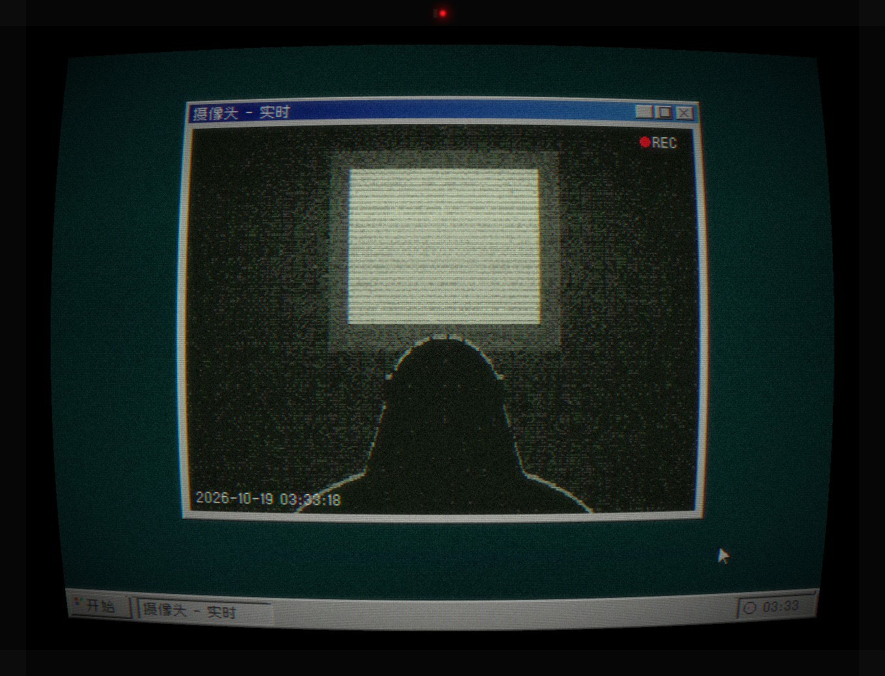

# No.01《03:33》

凌晨三点三十三分，一台没关的 Win98。

- **日记.txt**：「今天和她一起画画了」「她说明天还会来」→「她没有来」重复、变短、烂成乱码 →「门 没 有 锁」「我 在 门 后 面 等」。写日记的是「他」。
- **mom.jpg**：走廊尽头的门里站着一个人。全画唯一的红色是他的眼睛。
- **报错雪崩**：「系统找不到指定的人：绮思」「无法关闭“他.exe”：程序没有响应」「“他.exe”正在使用 摄像头」……最前面那个问「你要去哪里？」，两个按钮都是 [不要]。
- 任务栏「他.exe (未响应)」，托盘里摄像头亮着，时间 03:33。


```bash
python desktop_0333.py 1
```

## 视频版
`video_0333.py`：36 秒病娇录屏，需要 ffmpeg。

```bash
python video_0333.py 1
```
[](../../examples/01_video_0333_s1.mp4)
